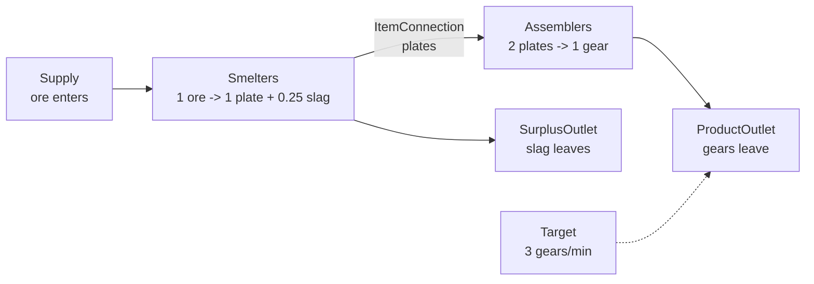
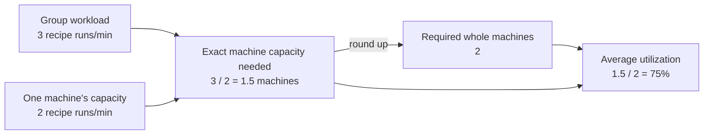

# FactoryGraph

FactoryGraph is a .NET library for planning steady-state production networks. You describe recipes, groups of machines, connections, external inputs, and desired outputs. The library computes the machine activity and item flow needed to meet those outputs.

FactoryGraph answers questions such as:

- How many machines does a production target require?
- How much input must enter the factory?
- How much material flows between production steps?
- Which outputs must leave as products or surplus?
- Can the factory meet the target without exceeding its throughput limits?

The built-in solver supports target-driven planning for graphs whose production flow does not loop back to an earlier step. These are called acyclic graphs. The solver does not schedule individual machines or simulate a factory over time.

## Mental Model

### Steady-State Planning

"Steady state" means every rate represents sustained operation after the factory has settled. During each minute, machine groups consume, produce, and transfer material at constant average rates.

A **rate** is a quantity per time unit, such as items per minute or recipe activities per second. A **capacity** is an upper bound on a rate. FactoryGraph does not attach a unit to numbers, so every rate and capacity in one request must use the same time unit.

For example, a steady-state result may say:

- ore enters at 6 items per minute;
- smelters produce 6 plates per minute;
- assemblers consume those 6 plates per minute; and
- 3 gears leave the factory per minute.

Inputs equal consumption, and production equals outgoing flow. Material does not accumulate inside the graph.

FactoryGraph does not model startup time, transport delay, storage, machine scheduling, or rate changes over time. This README uses minutes.

### Running Example

The examples use this ore-to-gears factory:



The target asks for 3 gears per minute. Producing them requires:

1. 3 assembler activities per minute to make 3 gears.
2. 6 plates per minute because each assembler activity consumes 2 plates.
3. 6 smelter activities per minute to make those plates.
4. 6 ore per minute and an outlet for 1.5 slag per minute.

The solver computes these rates from the graph instead of requiring the caller to calculate them.

## Graph Concepts

### Catalog And Production

| Concept             | Meaning                                                   | Why it exists                                                                                    |
|---------------------|-----------------------------------------------------------|--------------------------------------------------------------------------------------------------|
| `Item`              | A material or product, such as ore, plate, gear, or slag. | Recipes and flows refer to stable item IDs.                                                      |
| `Recipe`            | The inputs consumed and outputs produced by one activity. | It defines conversion ratios independently of machine speed or count.                            |
| `RecipeItem.Amount` | The quantity consumed or produced per activity.           | Multiplying this amount by solved activity gives an item rate.                                   |
| `MachineGroup`      | A group of interchangeable machines running one recipe.   | The solver can plan their combined throughput without representing each machine as a graph node. |

An **activity** is one execution of a recipe. If the gear recipe consumes 2 plates and produces 1 gear, an activity rate of 3 per minute consumes 6 plates per minute and produces 3 gears per minute.

```text
item rate = recipe amount x activity rate
```

Recipe amounts do not carry a time unit. Machine-group activity turns those per-activity amounts into rates such as items per minute.

### Machine Speed And Capacity

`MachineGroup` has three values that describe throughput:

| Property                 | Meaning                                                       | When to use it                                                                                                              |
|--------------------------|---------------------------------------------------------------|-----------------------------------------------------------------------------------------------------------------------------|
| `ActivityRatePerMachine` | Activities completed by one fully used machine per time unit. | Always set it. It converts solved activity into a machine count.                                                            |
| `AvailableMachineCount`  | Number of installed machines available to the group.          | Set it when the existing machine count must limit production. Leave it `null` when the solver may infer any required count. |
| `ActivityCapacity`       | Maximum activity rate for the whole group.                    | Set it when you know a direct group throughput limit. Leave it `null` when no separate activity limit applies.              |

`ActivityCapacity` is useful when you know a group's measured or configured throughput limit even if its machine count and per-machine rate would allow more. It uses activities per time unit because one recipe activity can consume or produce several different items.

Convert a machine's recipe duration to `ActivityRatePerMachine` before building the graph. A machine that completes one activity every 30 seconds completes 2 activities per minute. Speed modifiers belong in this converted rate because FactoryGraph does not store recipe duration or machine speed separately. An `AvailableMachineCount` of zero disables the group; `null` removes the machine-count limit.

Suppose each smelter completes 2 recipe activities per minute:

- `ActivityRatePerMachine = 2`
- `AvailableMachineCount = 4` allows at most `4 x 2 = 8` activities per minute.
- `ActivityCapacity = 7` lowers that group limit to 7 activities per minute.

When both limits exist, both apply:

```text
activity <= AvailableMachineCount x ActivityRatePerMachine
activity <= ActivityCapacity
```

The result reports three machine-count values:

| Result                      | Calculation                                         | Meaning                                                                                                         |
|-----------------------------|-----------------------------------------------------|-----------------------------------------------------------------------------------------------------------------|
| `EffectiveMachineCount`     | `Activity / ActivityRatePerMachine`                 | The exact machine capacity used. This value may be fractional because the planning model uses continuous rates. |
| `RequiredWholeMachineCount` | Tolerance-aware ceiling of effective count          | The number of whole machines needed to provide that capacity.                                                   |
| `Utilization`               | `EffectiveMachineCount / RequiredWholeMachineCount` | Average use of the required machines. It does not measure use of every installed machine.                       |

For 3 assembler activities per minute and `ActivityRatePerMachine = 2`, the effective count is 1.5 machines. The result requires 2 whole machines at 75% average utilization.



### Connections And Boundaries

A graph must identify where each item comes from and where each produced item goes.

| Concept          | Direction                      | Purpose                                                                                        |
|------------------|--------------------------------|------------------------------------------------------------------------------------------------|
| `ItemConnection` | Machine group to machine group | Keeps an item inside the graph and transfers it from a producing recipe to a consuming recipe. |
| `Supply`         | Outside to machine group       | Provides an external input such as mined ore or imported material.                             |
| `ProductOutlet`  | Machine group to outside       | Delivers an intended product such as gears.                                                     |
| `SurplusOutlet`  | Machine group to outside       | Carries excess or byproduct output that is not an intended delivery.                            |
| `Target`         | Refers to a product outlet     | Requests a minimum delivery rate without changing the reusable graph topology.                 |

`ProductOutlet` says where an intended product leaves the graph. `Target` says how much that outlet must deliver for one solve request. This separation lets callers reuse the same graph with different goals. Each product outlet may have at most one target; use separate product outlets for separate destinations.

Every connection and boundary can have a `Capacity`, expressed as an item rate. For example, a connection capacity of 5 means at most 5 items per minute may flow through it. A `null` capacity means that element does not impose an upper bound.

- A connection capacity represents a transfer limit between two machine groups.
- A supply capacity limits how much external input is available.
- A product-outlet capacity limits how much an external destination accepts.
- A surplus-outlet capacity limits how much excess output the factory can discard or store outside the graph.

The solver enforces exact item balance at every machine group:

```text
incoming connections + supplies = recipe input amount x activity
outgoing connections + product outlets + surplus outlets = recipe output amount x activity
```

This balance explains why the smelter needs a slag `SurplusOutlet`. The recipe produces slag whenever it produces plates, so the graph needs a valid outlet for that slag.

### Graph Definition And Identity

`FactoryGraphDefinition` contains the item and recipe catalogs plus the graph topology. **Topology** means the arrangement of machine groups, connections, and boundaries. Keeping targets outside this definition lets an application reuse one factory layout for many production requests.

Items and recipes use caller-assigned string IDs. Machine groups, connections, supplies, product outlets, surplus outlets, and targets use `Guid` IDs. IDs connect references in the request and let callers match computed values to their source elements. Keep every ID stable and unique within its element type.

## Solving A Graph

A `SolveRequest` combines four decisions:

1. `Graph` defines the reusable catalog and topology.
2. `Targets` define the output rates requested for this solve.
3. `Mode` defines the planning direction.
4. `Objective` chooses between valid plans when several can meet the targets.

`FactoryGraphProcessor.Solve` first validates IDs, references, item compatibility, numeric values, and the mode-objective combination. It returns `InvalidRequest` without calling the solver when validation fails.

The parameterless `FactoryGraphProcessor` uses the built-in solver. The constructor that accepts `Func<SolveRequest, SolveResult>` lets an application keep FactoryGraph validation while replacing the solve stage; the delegate receives only valid requests.

For a valid target-driven request, each recipe balance, target, and capacity becomes a **constraint**, which is a rule every plan must satisfy. The **objective** tells the solver which valid plan to prefer.

The built-in processor currently implements `PlanningMode.TargetDriven`. This mode treats every target as a required minimum and computes the activity and flow needed to meet all targets within capacity limits.

`PlanningMode.CapacityDriven` and `SolveObjective.MaximizeTargetOutput` exist in the public contracts, but the built-in processor does not implement that mode yet. A valid capacity-driven request returns `SolveStatus.Failed` with diagnostic code `solver.mode.not-implemented`.

### Objectives

A graph can contain several valid ways to meet the same targets. Target-driven planning supports:

| Objective | Behavior | Use it when |
|---|---|---|
| `MeetTargetsMinimizeExternalSupply` | Minimizes the sum of all `Supply` flows. | You want the lowest total external input rate. |
| `MeetTargetsMinimizeSurplus` | Minimizes the sum of all `SurplusOutlet` flows. | You want the lowest total excess-output rate. |

Both objectives use unweighted sums. The model does not assign different costs to different item types.

After optimizing the selected value, the solver minimizes total machine activity without degrading that value beyond the configured numeric tolerance. This removes unnecessary production in disconnected or optional paths.

### Complete Example

```csharp
using FactoryGraph;
using FactoryGraph.Contracts;

var smeltersId = Guid.NewGuid();
var assemblersId = Guid.NewGuid();
var plateConnectionId = Guid.NewGuid();
var oreSupplyId = Guid.NewGuid();
var gearOutletId = Guid.NewGuid();
var slagOutletId = Guid.NewGuid();
var gearTargetId = Guid.NewGuid();

var graph = new FactoryGraphDefinition(
    Items:
    [
        new Item("ore", "Ore"),
        new Item("plate", "Iron plate"),
        new Item("gear", "Gear"),
        new Item("slag", "Slag")
    ],
    Recipes:
    [
        new Recipe(
            "smelt",
            "Smelt ore",
            Inputs: [new RecipeItem("ore", 1)],
            Outputs:
            [
                new RecipeItem("plate", 1),
                new RecipeItem("slag", 0.25)
            ]),
        new Recipe(
            "assemble-gear",
            "Assemble gear",
            Inputs: [new RecipeItem("plate", 2)],
            Outputs: [new RecipeItem("gear", 1)])
    ],
    MachineGroups:
    [
        new MachineGroup(
            smeltersId,
            RecipeId: "smelt",
            ActivityRatePerMachine: 2,
            AvailableMachineCount: 4,
            ActivityCapacity: 7),
        new MachineGroup(
            assemblersId,
            RecipeId: "assemble-gear",
            ActivityRatePerMachine: 2,
            AvailableMachineCount: 2)
    ],
    Connections:
    [
        new ItemConnection(
            plateConnectionId,
            SourceMachineGroupId: smeltersId,
            DestinationMachineGroupId: assemblersId,
            ItemId: "plate")
    ],
    Supplies:
    [
        new Supply(
            oreSupplyId,
            DestinationMachineGroupId: smeltersId,
            ItemId: "ore",
            Capacity: 10)
    ],
    ProductOutlets:
    [
        new ProductOutlet(
            gearOutletId,
            SourceMachineGroupId: assemblersId,
            ItemId: "gear",
            Capacity: 5)
    ],
    SurplusOutlets:
    [
        new SurplusOutlet(
            slagOutletId,
            SourceMachineGroupId: smeltersId,
            ItemId: "slag",
            Capacity: 2)
    ]);

var request = new SolveRequest(
    graph,
    Targets: [new Target(gearTargetId, gearOutletId, Rate: 3)],
    Mode: PlanningMode.TargetDriven,
    Objective: SolveObjective.MeetTargetsMinimizeExternalSupply,
    Options: new SolverOptions(new NumericPolicy()));

var result = FactoryGraphProcessorFactory.Create().Solve(request);

if (result.Graph is { } solved &&
    result.Status is SolveStatus.Optimal or SolveStatus.Feasible)
{
    var smelters = solved.MachineGroups.Single(group => group.Id == smeltersId);
    var assemblers = solved.MachineGroups.Single(group => group.Id == assemblersId);

    Console.WriteLine($"Ore: {solved.Supplies.Single().ProvidedRate}/min");
    Console.WriteLine($"Smelters: {smelters.RequiredWholeMachineCount}");
    Console.WriteLine($"Assemblers: {assemblers.RequiredWholeMachineCount}");
    Console.WriteLine($"Gears: {solved.ProductOutlets.Single().DeliveredRate}/min");
    Console.WriteLine($"Slag: {solved.SurplusOutlets.Single().FlowRate}/min");
}
else
{
    foreach (var diagnostic in result.Diagnostics)
    {
        Console.Error.WriteLine($"{diagnostic.Code}: {diagnostic.Message}");
    }
}
```

The optimal result contains these values:

| Element             |                            Solved value | Reason                                                 |
|---------------------|----------------------------------------:|--------------------------------------------------------|
| Ore supply          |                                   6/min | Six smelter activities consume one ore each.           |
| Smelter activity    |                                   6/min | Six plates are needed.                                 |
| Smelters            |  3 effective, 3 whole, 100% utilization | Each smelter performs 2 activities per minute.         |
| Plate connection    |                                   6/min | Assemblers consume two plates for each of three gears. |
| Assembler activity  |                                   3/min | Each activity produces one gear.                       |
| Assemblers          | 1.5 effective, 2 whole, 75% utilization | Each assembler performs 2 activities per minute.       |
| Gear product outlet |                                   3/min | The target requests 3 gears per minute.                |
| Slag surplus outlet |                                 1.5/min | Each smelter activity also produces 0.25 slag.         |

## Reading Results

`SolveResult.Status` tells you whether the processor produced a usable plan:

| Status           | Meaning                                                                                                            |
|------------------|--------------------------------------------------------------------------------------------------------------------|
| `Optimal`        | The solver found and proved the best plan for the selected objective.                                              |
| `Feasible`       | The solver found a valid plan but stopped before proving it optimal, usually because of a time or iteration limit. |
| `InvalidRequest` | Contract validation failed. Inspect `Diagnostics`; `Graph` is `null`.                                              |
| `Infeasible`     | No plan can satisfy all targets and capacities.                                                                    |
| `Unbounded`      | The objective can improve without a finite limit.                                                                  |
| `Failed`         | The processor or backend could not classify or solve the request.                                                  |

For `Optimal` and `Feasible` results, `Graph` retains the input topology and adds solved values:

- machine groups report activity, input and output rates, effective count, whole count, and utilization;
- connections report flow rates;
- supplies report required, provided, and deficit rates;
- product outlets report delivered rates;
- surplus outlets report their flow rates; and
- targets report requested, achieved, surplus, and deficit rates.

A target requests a minimum, so its achieved rate can exceed its requested rate when shared production or recipe co-products force extra delivery. `SurplusRate` and `DeficitRate` report that difference.

Target surplus and `SurplusOutlet` flow describe different values. Target surplus measures delivery above a requested rate. A surplus outlet carries a physical item flow out of the graph.

In target-driven results, exact input balance makes each supply's `RequiredRate` equal its `ProvidedRate`, with zero `DeficitRate`. The three fields distinguish the amount needed, the amount delivered, and any missing amount.

Diagnostics contain a stable `Code`, a caller-facing `Message`, a `Severity`, and references to related graph elements. Use the code, rather than the message, for program logic.

`Bottlenecks` belongs to result modes that identify capacities limiting maximum output. The current target-driven solver returns an empty bottleneck list.

## Numeric Behavior

Factory planning uses floating-point arithmetic, so mathematically equal values can differ by small rounding errors. `NumericPolicy` defines how the library compares and reports those values:

| Property | Default | Purpose |
|---|---:|---|
| `AbsoluteTolerance` | `1e-9` | Allows a fixed difference when comparing two values. |
| `RelativeTolerance` | `1e-9` | Scales comparison tolerance for large values. |
| `NearZeroThreshold` | `1e-12` | Reports tiny positive or negative values as positive zero. |

The same policy prevents a value such as `2.0000000001` from requiring 3 whole machines when it is within tolerance of 2. Change the defaults only when the scale or precision of your domain requires it.

`SolverOptions.TimeLimit` sets the total caller-defined limit for target optimization and the follow-up machine-activity minimization. A `null` value applies no caller-defined time limit.

`SolverOptions` groups the numeric policy and time limit so callers can reuse the same execution settings across requests.

## Current Scope

The built-in solver currently provides:

- target-driven planning for acyclic graphs;
- multiple targets on distinct product outlets;
- multiple inputs and outputs per recipe;
- splits, merges, fan-in, fan-out, and disconnected graph sections;
- machine, activity, connection, supply, product-outlet, and surplus-outlet capacities; and
- continuous activity and flow rates.

It does not currently provide:

- capacity-driven maximum-output planning;
- supported semantics for production cycles;
- time-based simulation, inventory, transport, or scheduling; or
- integer optimization of machine counts.

`RequiredWholeMachineCount` is a derived ceiling. The solver optimizes continuous activity rates rather than choosing integer machine counts.

## Runtime Support

FactoryGraph targets .NET 10 and uses [HiGHS](https://highs.dev/) through `Highs.Native`. The package supplies native solver libraries for `win-x64`, `win-x86`, `linux-x64`, `linux-arm64`, `osx-x64`, and `osx-arm64`. Other runtimes must supply a compatible HiGHS native library.

## Repository

| Project | Purpose | Package |
|---|---|---|
| `src/FactoryGraph` | Contracts, validation, and planning | `FactoryGraph` |
| `src/FactoryGraph.Exporter.Mermaid` | Mermaid output for computed graphs | `FactoryGraph.Exporter.Mermaid` |
| `tests/FactoryGraph.Tests` | Contract, validation, solver, and scenario tests | Not packable |
| `benchmarks/FactoryGraph.Benchmarks` | Reproducible performance benchmarks | Not packable |

.NET 10 is required. The SDK feature band is pinned by `global.json`.

```console
dotnet restore FactoryGraph.slnx
dotnet build FactoryGraph.slnx --configuration Release --no-restore
dotnet test FactoryGraph.slnx --configuration Release --no-build
dotnet pack src/FactoryGraph/FactoryGraph.csproj --configuration Release --no-build
dotnet pack src/FactoryGraph.Exporter.Mermaid/FactoryGraph.Exporter.Mermaid.csproj --configuration Release --no-build
```

See [CONTRIBUTING.md](CONTRIBUTING.md) for development and release conventions. Issues are tracked in the [Factory Planner issue tracker](https://github.com/caneva20/factory-planner/issues).

## Detailed Documentation

- [Public Contracts](docs/contracts.md) lists identity, topology, result, and collection rules.
- [Target-Driven Planning](docs/target-driven-planning.md) defines the optimization model and status mapping.
- [Request Validation](docs/validation.md) lists validation rules and stable diagnostic codes.
- [Solver Backend](docs/solver-backend.md) lists the native solver dependency and supported runtimes.
- [Scenarios](docs/scenarios.md) explains executable planning examples.
- [Future Graph Constraints](docs/future-constraints.md) records requirements for future fixed and bounded values.
