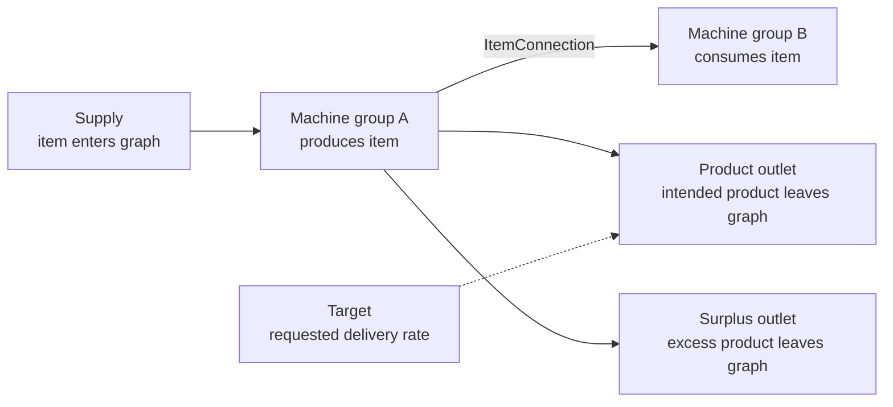

# Public Contracts

`FactoryGraph.Contracts` defines planning requests and results. Start with the README's [mental model](../README.md#mental-model) for steady state, activity, rates, machine counts, and graph boundaries. The contracts do not validate or solve graphs.

## Core Concepts

A factory graph describes item flow through a production line:

- An `Item` identifies a material or product.
- A `Recipe` defines the items consumed and produced by one activity.
- A `MachineGroup` runs one recipe at a solved activity rate.
- An `ItemConnection` carries a produced item to another machine group that consumes it.
- A `Supply` brings an item into the graph for a machine group to consume.
- A `ProductOutlet` takes an intended product out of the graph.
- A `Target` requests a delivery rate for one product outlet.
- A `SurplusOutlet` takes excess output.



If a machine group produces ten gears per minute, it can send six through a connection and four through a product outlet. A target of four requires the solver to deliver four gears per minute to that outlet.

`ProductOutlet` identifies where an intended product leaves the graph. `Target` supplies the requested rate, allowing callers to reuse a graph with different production goals. Use separate product outlets for distinct external destinations.

## Identity

Items and recipes use caller-assigned string IDs. Other entities use `Guid` IDs.

| Entity | ID type |
|---|---|
| Item | `string` |
| Recipe | `string` |
| Machine group | `Guid` |
| Item connection | `Guid` |
| Supply | `Guid` |
| Product outlet | `Guid` |
| Target | `Guid` |
| Surplus outlet | `Guid` |

IDs must remain stable within a request. Results retain input IDs and topology references.

## Rates And Activity

All rates in a request use one time unit, such as items per minute.

- `RecipeItem.Amount` is the quantity consumed or produced per activity unit.
- `MachineGroup.ActivityRatePerMachine` is the activity per machine per time unit.
- Effective machine count is activity divided by activity rate per machine.
- Required whole-machine count is the tolerance-aware ceiling of effective machine count.
- Utilization is effective machine count divided by required whole-machine count.
- `AvailableMachineCount` limits activity through the number of installed machines.
- `ActivityCapacity` directly limits activity per time unit.
- When both machine count and activity capacity are present, both constraints apply.
- Connection and boundary capacities are item rates. A `null` capacity is unbounded.

## Topology And Boundaries

An `ItemConnection` carries one item between machine groups. The source recipe must produce the item, and the destination recipe must consume it.

A `Supply` feeds a machine-group input. A `ProductOutlet` delivers an intended machine-group output. A `Target` sets a requested rate for a product outlet. A `SurplusOutlet` accepts excess output.

Contracts permit malformed values. `FactoryGraphProcessor` reports duplicate IDs, missing endpoints, incompatible items, and invalid numbers before solving. See [Request Validation](validation.md) for the complete rules and diagnostic codes.

## Planning Modes

`TargetDriven` computes the activity and resources needed to meet target rates within configured limits.

Each product outlet may have at most one target.

```csharp
var request = new SolveRequest(
    graph,
    [new Target(targetId, productOutletId, Rate: 10)],
    PlanningMode.TargetDriven,
    SolveObjective.MeetTargetsMinimizeExternalSupply,
    new SolverOptions(new NumericPolicy()));
```

`CapacityDriven` represents maximum-output planning in the public contracts. The built-in processor does not implement this mode and returns `Failed` with diagnostic code `solver.mode.not-implemented`.

See `tests/FactoryGraph.Tests/Contracts/TargetDrivenContractTests.cs` for the target-driven contract shape.

## Results

`SolveResult` contains a status, an optional computed graph, diagnostics, and bottlenecks. The computed graph includes the catalog and topology.

Machine-group results include activity, machine counts, utilization, and item rates. Boundary and target results include required, provided, achieved, surplus, and deficit rates. Connections include flow rates. Bottlenecks reference a machine group, connection, or supply.

The target-driven solver returns an empty bottleneck list. The computed graph is absent for `InvalidRequest`, `Infeasible`, `Unbounded`, and `Failed` results.

## Numeric Policy

`NumericPolicy` defines floating-point comparisons:

- Two values are nearly equal when `abs(left - right) <= max(absoluteTolerance, relativeTolerance * max(abs(left), abs(right)))`.
- A value normalizes to positive zero when `abs(value) <= nearZeroThreshold`.
- Solvers normalize reported rates and residuals before constructing results.
- Whole-machine ceiling must treat values nearly equal to an integer as that integer before applying `Ceiling`.

The default absolute and relative tolerances are `1e-9`; the default near-zero threshold is `1e-12`.

## Collection Ownership

Contract records expose collections as `IReadOnlyList<T>` without copying them. Callers must not modify collections while a request is in use. Processors must not mutate requests or their collections.

## Future Constraints

The requirements and compatibility boundaries for future fixed, minimum, and maximum graph values are documented in [Future Graph Constraints](future-constraints.md). The current contracts intentionally do not expose a speculative generalized constraint API.
