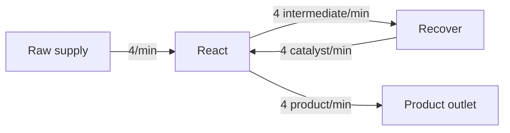

# Recycling Cycles

A recycling cycle returns an item to a machine group on the same directed production path. Its machine groups form a strongly connected component: every group in the component can reach every other group through item connections. A self-loop is a one-group component.

## Steady-State Solve

FactoryGraph creates activity and flow variables for the whole graph and solves their balances in one linear program. Cyclic rates therefore resolve at the same time as external supplies, products, surplus, targets, and capacities. The solver does not cut a cycle or choose a traversal order.

For a lossy recycle, external supply must replace the material lost on each pass. A process that consumes 1 catalyst and recovers 0.75 catalyst needs 0.25 external catalyst per activity at steady state. Capacity limits can make a target-driven request infeasible. A capacity-driven cycle can be unbounded when no machine, flow, or boundary capacity limits target output.

## Worked Example

The `SimpleLoop` scenario converts raw material into product while circulating one catalyst through two machine groups:

`React` consumes one raw item and one catalyst, then produces one intermediate and one product. `Recover` consumes one intermediate and returns one catalyst. The request targets 4 product per minute. Its product outlet has capacity 4, and the other boundaries and machine groups have no capacity limit.

Both the target-driven and capacity-driven cases produce the same rates:

| Result                                      | Value  |
|---------------------------------------------|-------:|
| `React` activity                            |  4/min |
| `Recover` activity                          |  4/min |
| Raw external supply                         |  4/min |
| Intermediate connection                     |  4/min |
| Catalyst return connection                  |  4/min |
| Product delivery                            |  4/min |
| `RequiresStartupInventory`                  | `true` |

The catalyst balances at steady state, so the solve needs no external catalyst flow. The empty factory cannot perform the first `React` activity because no catalyst exists yet, so cycle analysis marks the component as requiring startup inventory. This flag does not change the solved rates.

See the [scenario explanation](scenarios/simple-recycling-loop.md) and the [complete JSON request and expected result](../tests/FactoryGraph.Tests/Scenarios/Cycles/SimpleLoop/scenario.json).

## Cycle Analysis

`SolveResult.Analysis.CyclicComponents` identifies each multi-group strongly connected component and each self-loop. A component contains:

- `MachineGroupIds`, ordered by machine-group declaration;
- `ConnectionIds` for connections whose source and destination both belong to the component, ordered by connection declaration; and
- `RequiresStartupInventory`, a structural startup classification.

Components follow the declaration order of their first machine group. Connections between separate components do not belong to either component.

The processor performs this analysis after request validation and before solving. Optimal, feasible, infeasible, unbounded, and failed results retain it. Invalid requests return empty analysis.

## Startup Classification

Steady-state equations can describe a sustainable cycle that cannot begin from an empty factory. FactoryGraph marks such a component with `RequiresStartupInventory = true`.

The analysis starts with recipes that consume no inputs. It then marks a group startable when every distinct recipe input can come from either:

- an external supply with no capacity limit or a capacity above the request's near-zero threshold; or
- an incoming connection from a group already marked startable.

It repeats this step across the full graph so an upstream group or cycle can start a downstream cycle. A cyclic component requires startup inventory when this process cannot mark every member startable.

This classification tests structural availability, not quantity. It does not compare supply rates with recipe consumption, inspect connection or machine capacity, calculate bootstrap inventory, model startup timing, or alter feasibility. The linear solver remains responsible for steady-state rate and capacity constraints.
